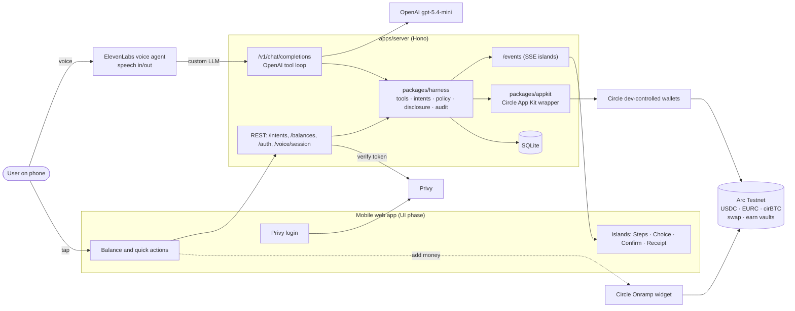
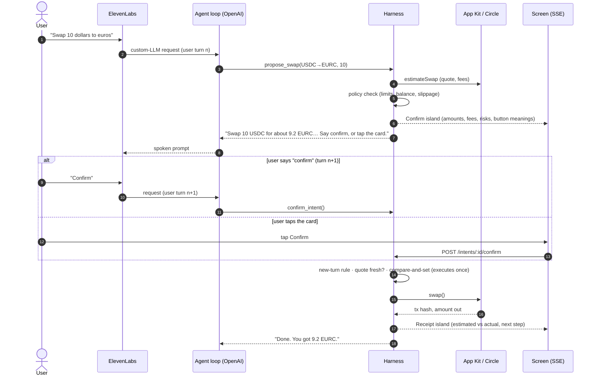

# Arcie architecture

The full design is in `.claude/specs/2026-11-06-arcie-backend-design.md`.

## Components

## The confirmation flow (why the AI can't move money by itself)

Key rules, enforced in code (spec §8.3):
- **The model can only propose.** Execution happens only through `harness.confirm`.
- **A spoken "yes" counts only on a new user turn**, so the model can't confirm its own proposal.
- **Confirm runs exactly what the card showed.** The parameters are hashed, and a stale quote is re-checked.
- **At most once:** a voice "yes" and a tap at the same moment execute a single time.
- **Limits are checked before any card appears.** Default limits: $50 per transaction, $200 per day. A new recipient needs a tap.

## Arc Testnet findings (live smoke test, 2026-11-07)

`pnpm smoke` passed 15 of 15 steps with the demo wallet. Every AppKitPort method was exercised against Arc Testnet through `@circle-fin/app-kit` 1.21.0 and the circle-wallets adapter.

| Topic | Finding |
|---|---|
| Wallet account type | **EOA** dev-controlled wallets work for send, swap, earn, and withdraw. USDC is the gas token, so no separate gas funding is needed. |
| Wallet set | Created by `pnpm provision`; the id is stored in `.env` (`CIRCLE_WALLET_SET_ID`). |
| Token addresses | USDC `0x3600000000000000000000000000000000000000` (6 dp ERC-20 interface), EURC `0x89B50855Aa3bE2F677cD6303Cec089B5F319D72a` (6 dp), cirBTC `0xf0C4a4CE82A5746AbAAd9425360Ab04fbBA432BF` (8 dp). |
| Native gas | Arc's native currency is USDC with **18 decimals**. `estimateSend` and the earn `gasFees` return fees in native base units, so we convert them with `nativeFeeToGasToken`. Swap fees already come back as human-readable amounts. |
| Typical fees | send ≈ 0.0035–0.0053 USDC · swap ≈ 0.045 USDC network + 0.0002 USDC provider · vault deposit ≈ 0.011 USDC (approve + deposit) · withdraw ≈ 0.011 USDC. |
| Token rates | `getTokenRates` keys prices by **chain, then lowercase token address**. Testnet has prices for USDC and EURC but **none for cirBTC**. |
| Swap pricing | The testnet USDC→EURC pool is mispriced relative to the USD rates (1 USDC ≈ 1.47 EURC, while the EURC rate is ≈ $1.11). The estimate (1.4797) and the actual fill (1.4722) differed by about 0.5%, within the 1% slippage cap. |
| Vaults | `exploreVaults` returns "EarnKit USDC Vault (Arc Testnet)" `0xaabbef1d3971c710276ed41ec791bbe14cdb8e88` (4.2% APY) and "MockMorphoVault (Arc Testnet)" `0x8f2d33b5d4b9b5f02df635ae308f7b4c9da8d2dc` (3.5%). |
| First-time deposit | `getDepositQuote` returns two gas entries (approve + deposit). Both had estimates in our runs. |
| Position indexing | `getPosition` **lags the deposit by a few seconds**: it can return nothing, or an older balance, right after the deposit transaction. The harness must not take a position read immediately after a deposit as final. |
| Deposit rounding | A 1.00 USDC deposit shows as 0.999999 in the position, because of share-price rounding. |
| Onramp | A sandbox `createSession` with only `appUserId` + `destinationAddress` returns a `sessionToken` that's valid for about 30 minutes. |
